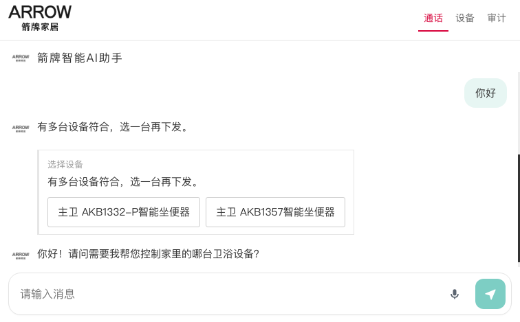
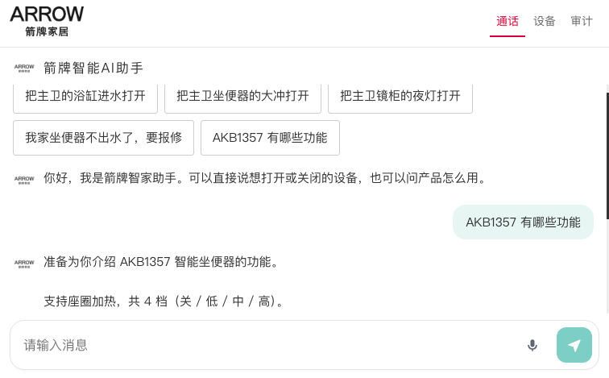
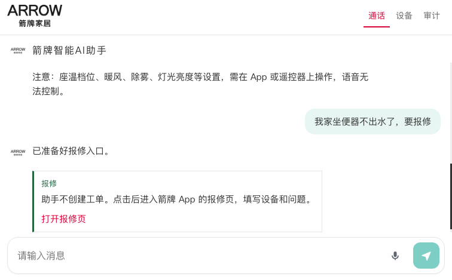
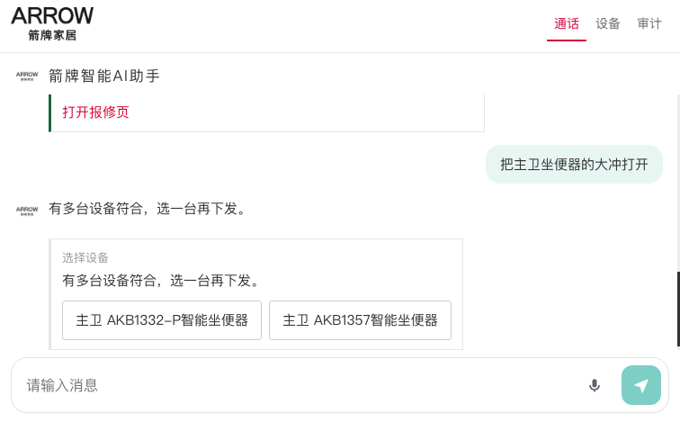
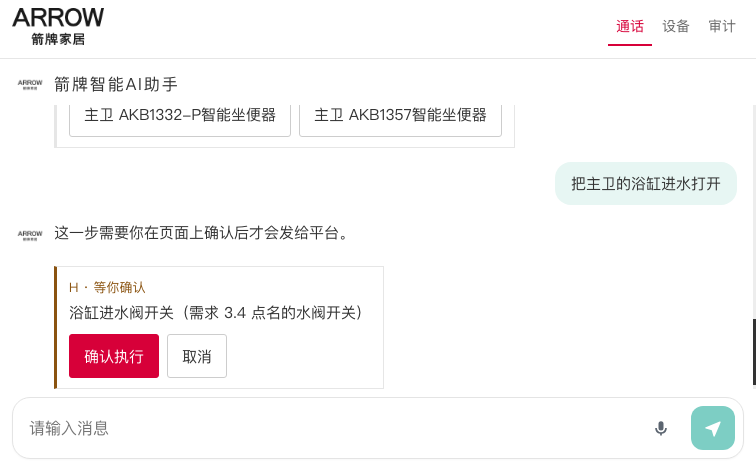
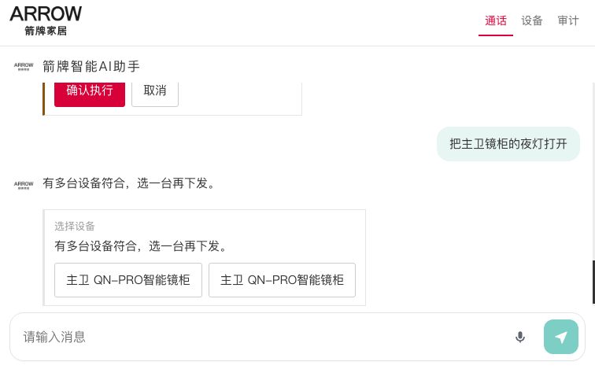
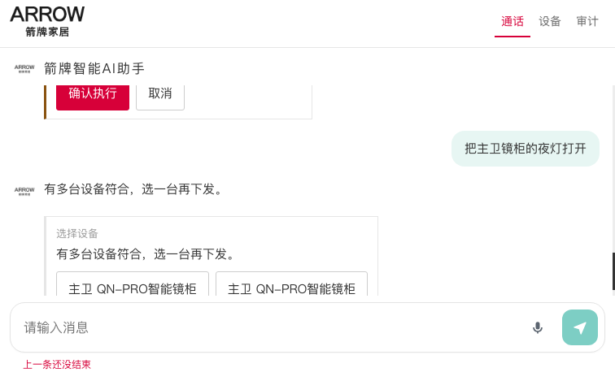
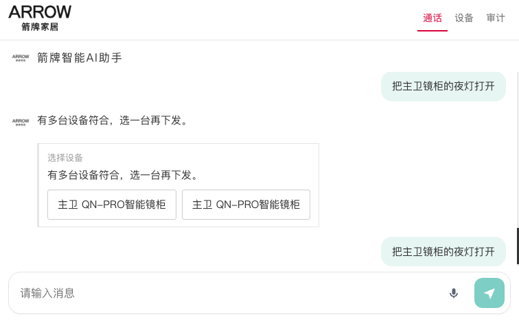
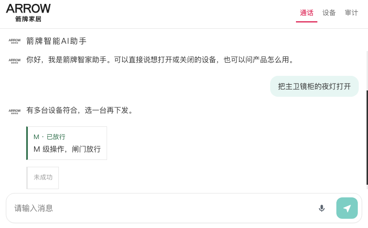

# 箭牌 H5 全量回复测试

- 日期：2026-10-11
- 环境：本机 `http://127.0.0.1:8900`，页面版本 `app.js?v=11`
- 房间：BRTC 已连接。设备网关为箭牌 UAT `https://api-uatiot.arrowgroup.com.cn`，家庭 `933`
- 客户公网：`http://106.55.21.235:8898` 仍是上一版，这次没有在那台机器上测

## 结论

产品问答、报修、设备选择和高风险确认可用。普通夜灯能选出主卫镜柜并下发到物联网平台，平台返回「设备离线」，所以页面显示「未成功」。语音识别的「没听清」不再进入对话。

连续提问已补上。设备卡不再挡住下一句。房间还在回答时，新的闲聊先排队，上一句结束后自动发出。2026-10-11 复测：先发「把主卫坐便器的大冲打开」，立刻再发「你好」，两句都有结果。

| 连续输入 | 输出 |
| --- | --- |
| 把主卫坐便器的大冲打开 | 有多台设备符合，选一台再下发。只列出主卫 AKB1332-P 和 AKB1357 |
| 你好 | 你好！请问需要我帮您控制家里的哪台卫浴设备？ |

单独再发一次「你好」，回复是：「你好！我是箭牌智家助手。请问今天想控制家里的哪台卫浴设备？」问候能接住，内容仍偏向设备操作。

| 类型 | 输入 | 用时 | 结果 |
| --- | --- | --- | --- |
| 产品问答 | AKB1357 有哪些功能 | 7.1 秒 | 通过 |
| 报修 | 我家坐便器不出水了，要报修 | 3.0 秒 | 通过 |
| 多设备 | 把主卫坐便器的大冲打开 | 7.0 秒 | 通过 |
| 高风险 | 把主卫的浴缸进水打开 | 3.0 秒 | 通过，未点确认 |
| 夜灯选择 | 把主卫镜柜的夜灯打开 | 3.1 秒 | 通过 |
| 闲聊 | 你好 | 复测有回复 | 通过，内容偏向设备操作 |
| 语音 | 没听清 / 把主卫镜柜的夜灯打开 | 帧模拟 | 通过 |
| 物联网下发 | 选中一台主卫镜柜夜灯 | 0.5 秒 | 指令已到达平台，设备离线 |

## 1. 产品问答

输入：`AKB1357 有哪些功能`

输出：

> 准备为你介绍 AKB1357 智能坐便器的功能。支持座圈加热，共 4 档（关 / 低 / 中 / 高）。支持大冲、小冲和脚触感应冲水。支持自动翻盖、夜灯、自动润瓷、整机开关。座温档位 10 档，范围 1 至 10，最热为 10 档。即热式供水，额定功率 1200 瓦。暖风烘干功能有 3 档，风温约 35 至 55 摄氏度。注意：座温档位、暖风、除雾、灯光亮度等设置，需在 App 或遥控器上操作，语音无法控制。

内容完整，并说明了语音不能控制的功能。

## 2. 报修

输入：`我家坐便器不出水了，要报修`

输出：

> 已准备好报修入口。

卡片：

- 标题：报修
- 说明：助手不创建工单。点击后进入箭牌 App 的报修页，填写设备和问题。
- 按钮：打开报修页，地址 `arrowhome://repair/create?from=ai_assistant`

这句话没有送进房间，所以不再停在「准备为你提交报修」。

## 3. 多设备选择

输入：`把主卫坐便器的大冲打开`

输出：

> 有多台设备符合，选一台再下发。

选择卡只列出：

- 主卫 AKB1332-P智能坐便器
- 主卫 AKB1357智能坐便器

没有把客卫、浴缸和镜柜混进来。这一步没有点选，所以没有下发。

## 4. 高风险确认

输入：`把主卫的浴缸进水打开`

输出：

> 这一步需要你在页面上确认后才会发给平台。

卡片：

- 等级：H · 等你确认
- 内容：浴缸进水阀开关（需求 3.4 点名的水阀开关）
- 按钮：确认执行、取消

这次没有点确认，水阀没有下发。

## 5. 夜灯选择

输入：`把主卫镜柜的夜灯打开`

输出：

> 有多台设备符合，选一台再下发。

选择卡只列出主卫两台 QN-PRO智能镜柜。两台名称相同，页面上看不出差别。

## 6. 闲聊

输入：`你好`

18.2 秒内没有形成这条输入对应的新回复。截图里能看到的助手文字，是进房时的开场白和前面几条设备结果。

## 7. 语音输入

麦克风在无头浏览器里没有真实收音，这一项用房间返回的识别帧验收。

- 送入「我没有听清，请再说一遍」：输入框下提示「没听清，按住说完再松开」，没有新的用户气泡。
- 送入「把主卫镜柜的夜灯打开」：这句话进入对话，并出现主卫两台镜柜的选择卡。

按住时的红色波纹需要在真实浏览器里按住麦克风查看，这次截图没有覆盖。

## 8. 物联网平台下发

另开一次对话，输入「把主卫镜柜的夜灯打开」，点选第一台「主卫 QN-PRO智能镜柜」。

页面结果：

- M · 已放行
- M 级操作，闸门放行
- 未成功

审计记录 `audit.jsonl` 最后一条，时间 `2026-10-11T07:30:19.511Z`：

- 请求：`POST https://api-uatiot.arrowgroup.com.cn/ext/v3/ai/control`
- 家庭：`933`
- 设备：`ARROW0617696743520408`，主卫 QN-PRO智能镜柜
- 指令：`switch_night_light`，`switch=on`
- 平台响应：HTTP 200，正文 `code 500`，`msg` 为「设备离线」
- 耗时：484 毫秒

指令格式和鉴权已经到达箭牌平台。设备当前离线，所以没有执行成功。这次没有对浴缸水阀和大冲点确认或下发。
