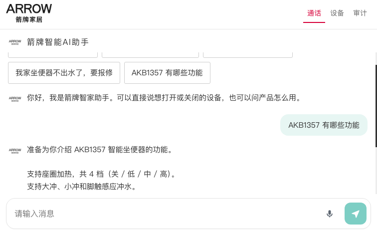
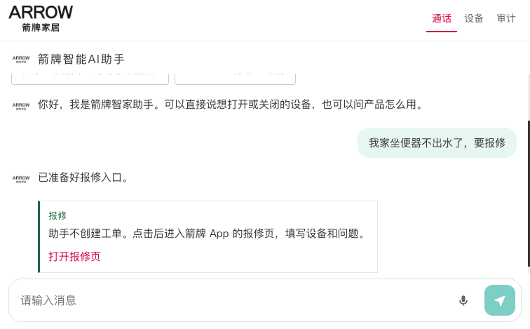
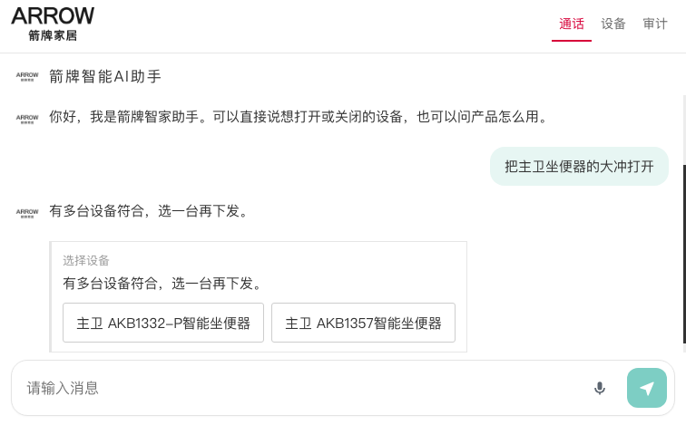
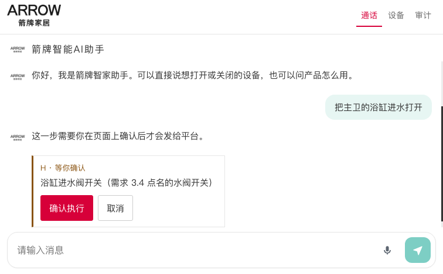
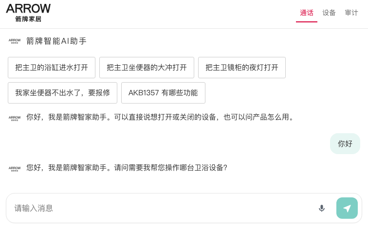
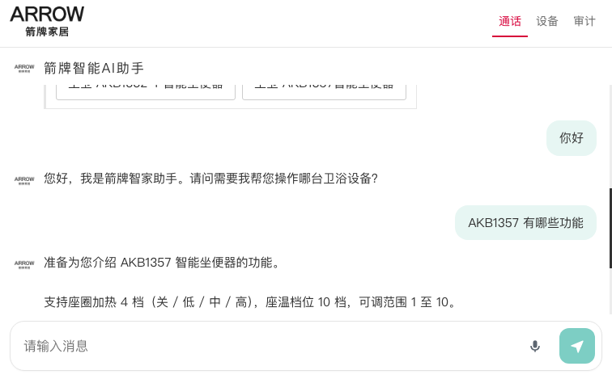
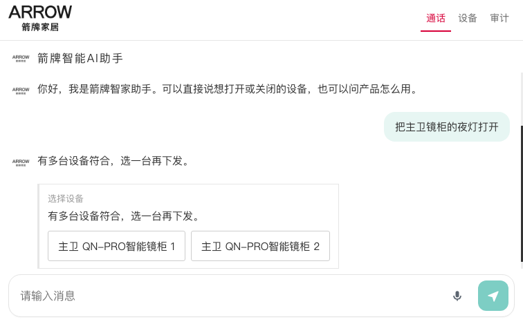

# 箭牌 H5 全量问答测试

- 日期：2026-10-11
- 页面：本机 `http://127.0.0.1:8900`，`app.js?v=13`
- 房间：每类问答单独进一次 BRTC 房间
- 设备：箭牌 UAT，家庭 `933`
- 客户公网 `http://106.55.21.235:8898` 仍是上一版，这次没有测

## 结论

八类里七类通过。产品问答、报修、坐便器选择、浴缸确认、夜灯选择、闲聊和连续提问都有对应输出。语音识别帧也按预期处理。

大冲的第一次进房连接失败，补测通过，只列出主卫两台坐便器。这次没有再向离线设备下发指令。

| 类型 | 输入 | 用时 | 结果 |
| --- | --- | --- | --- |
| 产品问答 | AKB1357 有哪些功能 | 6.1 秒 | 通过 |
| 报修 | 我家坐便器不出水了，要报修 | 3.0 秒 | 通过 |
| 多设备 | 把主卫坐便器的大冲打开 | 补测 | 通过 |
| 高风险 | 把主卫的浴缸进水打开 | 3.9 秒 | 通过，未点确认 |
| 夜灯 | 把主卫镜柜的夜灯打开 | 3.1 秒 | 通过 |
| 闲聊 | 你好 | 4.0 秒 | 通过 |
| 连续提问 | 大冲、你好、AKB1357 | 8.0 秒 | 通过，三句都有结果 |
| 语音 | 没听清 / 打开主卫镜柜夜灯 | 帧模拟 | 通过 |

## 1. 产品问答

输入：`AKB1357 有哪些功能`

输出：

> 准备为你介绍 AKB1357 智能坐便器的功能。支持座圈加热，共 4 档（关 / 低 / 中 / 高）。支持大冲、小冲和脚触感应冲水。支持自动翻盖、自动润瓷、夜灯、整机开关。座温档位 10 档，范围 1 至 10，最热为 10 档。暖风烘干有 3 档，风温约 35 至 55 摄氏度。采用即热式供水，额定功率 1200 瓦。座温、暖风、灯光、除雾等功能需在 App 或遥控器上操作，语音无法控制。

## 2. 报修

输入：`我家坐便器不出水了，要报修`

输出：「已准备好报修入口。」卡片说明助手不创建工单，按钮是「打开报修页」。

## 3. 多设备

输入：`把主卫坐便器的大冲打开`

第一次进房失败：`Error connecting to the Janus WebSockets server`。补测已连接，选择卡只列出：

- 主卫 AKB1332-P智能坐便器
- 主卫 AKB1357智能坐便器

## 4. 高风险

输入：`把主卫的浴缸进水打开`

输出：「这一步需要你在页面上确认后才会发给平台。」卡片为 H 级，内容是浴缸进水阀开关。没有点确认，没有下发。

## 5. 夜灯

输入：`把主卫镜柜的夜灯打开`

选择卡列出两台主卫镜柜，名称相同，分别标成「1」和「2」。没有点选，没有下发。

## 6. 闲聊

输入：`你好`

输出：「您好，我是箭牌智家助手。请问需要我帮您操作哪台卫浴设备？」

## 7. 连续提问

按顺序发送：

1. 把主卫坐便器的大冲打开
2. 你好
3. AKB1357 有哪些功能

三句都进入对话。大冲只列出主卫两台坐便器。你好得到设备操作引导。AKB1357 得到功能介绍，包含座圈、冲水、夜灯、座温和语音不能控制的项目。

## 8. 语音

无头浏览器没有真实麦克风，使用房间识别帧。

- 「我没有听清，请再说一遍」只显示「没听清，按住说完再松开」。
- 「把主卫镜柜的夜灯打开」进入对话，选择按钮为「主卫 QN-PRO智能镜柜 1」和「主卫 QN-PRO智能镜柜 2」。

## 物联网

这次没有点选或确认，所以没有新的下发。上一轮已确认指令能到达 `https://api-uatiot.arrowgroup.com.cn/ext/v3/ai/control`，平台对离线设备返回「设备离线」。
