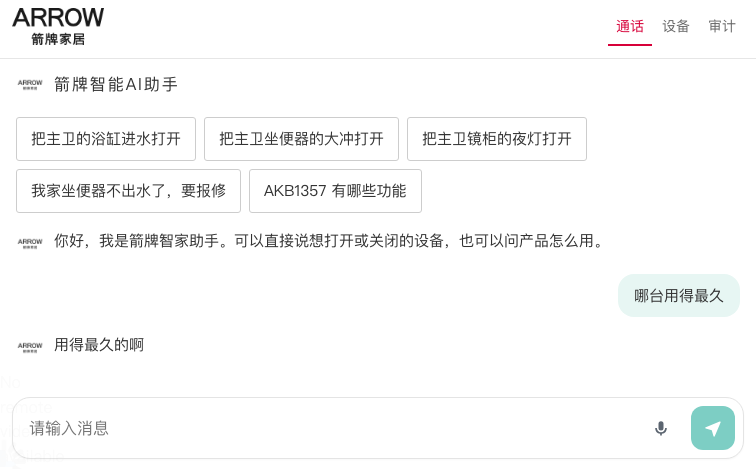

# 数据统计适配测试

- 日期：2026-10-11
- 页面：本机 `http://127.0.0.1:8900`，`app.js?v=16`
- 路径：H5 把问句送进 BRTC。控制台里的「数据统计」话题命中后，应按 OpenAI `chat/completions` 调用适配层，再由 DuMate 转述一句结论。
- 适配层本机 `8911` 没有启动。统计数字配置在适配层的 `IOT_CALLS_JSON` 和 `USAGE_DURATION_JSON`，不在 H5 里。

## 结论

两句意图都进了房间，也得到了口头回复，但都没有统计数字。适配层没有被这次回答用到。

| 话题 | 输入 | 用时 | 输出 | 结果 |
| --- | --- | --- | --- | --- |
| IoT 调用次数 `iot_calls` | 这个月调用了多少次 | 5.1 秒 | 调用次数啊 | 未得到次数、成功数和失败数 |
| 产品使用时长 `usage_duration` | 哪台用得最久 | 5.1 秒 | 用得最久的啊 | 未得到合计分钟和产品名 |

第一次测使用时长时，建房间返回 `fetch failed`，百度建实例短暂不可达。恢复后补测，房间已连接。

## 1. 调用次数

输入：`这个月调用了多少次`

输出只有：「调用次数啊」。没有「共调用多少次、成功多少次、失败多少次」。

## 2. 使用时长

输入：`哪台用得最久`

输出只有：「用得最久的啊」。没有合计分钟，也没有用得最久的产品名。

## 原因

适配层设计是：BRTC 话题外呼 `POST /v1/chat/completions`，Model ID 用 `iot_calls` 或 `usage_duration`。适配层先算出一句结论，配置了 DuMate 时再转述，失败时也返回已经算好的那句。

这次回答停在模型自己的口头重复。房间没有把适配层的 `choices[0].message.content` 回传到页面。本机也没有适配层进程，BRTC 云端即使配置了地址，也不会访问 `127.0.0.1:8911`。

要让这两句出现数字，适配层需要一个公网 HTTPS 地址，并填进控制台这个话题的服务请求地址。
