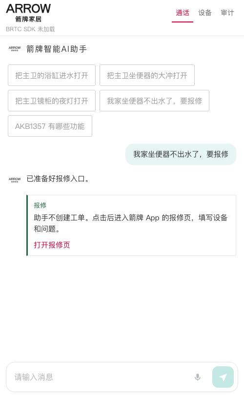
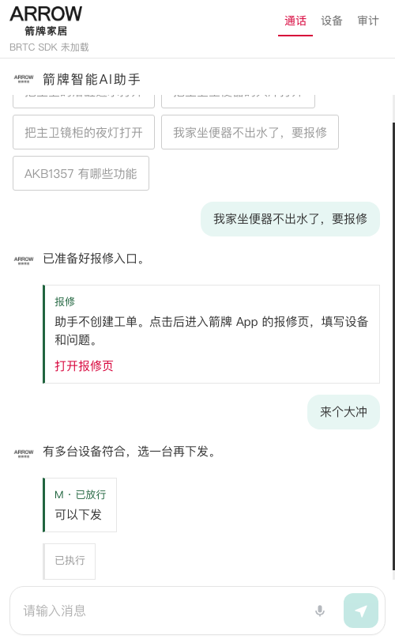

# 各类问题验收

- 日期：2026-10-12
- 服务：本机 `http://127.0.0.1:8913`，`IOT_MODE=mock`
- 页面：无头 Chrome，手机宽度 430×900
- 房间：这一轮 BRTC SDK 没有加载，产品问答和闲聊没有进入真实房间

## 结论

十类里，设备控制、报修、连续打断和字段追问在本轮通过。产品问答和闲聊只验证了「会交给房间、房间正文能进对话」，知识库和开场白的实际措辞没有在这一轮听到。

| 类型 | 输入 | 结果 | 说明 |
| --- | --- | --- | --- |
| 产品问答 | AKB1357 有哪些功能 | 路由通过 | 不进本地指令。接口回放的房间正文能进对话。知识库原文需真实房间 |
| 报修 | 我家坐便器不出水了，要报修 | 通过 | 页面出现报修卡和「打开报修页」 |
| 大冲 | 来个大冲 | 通过 | 6 台坐便器。点主卫后下发 `switch_watering/on`，页面显示「已执行」 |
| 小冲 | 帮我小冲 | 通过 | 6 台坐便器，`switch_watering_small/on`，模拟平台受理 |
| 关闭翻盖 | 把自动翻盖关掉 | 通过 | 6 台坐便器，`switch_auto_closing/off` |
| 关闭夜灯 | 别夜灯了 | 通过 | 3 台镜柜，`switch_night_light/off` |
| 进水 | 进水 | 通过 | 2 台浴缸。点选后停在 H 级确认，没有下发 |
| 闲聊 | 你好 | 路由通过 | 不进本地指令。接口回放的房间正文能进对话。开场白需真实房间 |
| 连续提问 | 来个大冲，接着你好 | 通过 | 新一句把上一句标成作废，只留下新一句 |
| 字段追问 | 请提供 device ID、name 以及 CMD | 通过 | 正文被滤成空，不进入对话 |
| 语音 | 没听清 / 来个大冲 | 通过 | 「没有听清」被丢掉；「来个大冲」保留。无头浏览器没有麦克风 |

## 页面

报修先出卡片。随后「来个大冲」列出设备，点主卫 AKB1332-P 后出现「M · 已放行」和「已执行」。再发「你好」时，页面不再等待上一句。

## 边界

无头 Chrome 提示「BRTC SDK 未加载」，所以没有进房，也没有听到 TTS。产品功能和闲聊原话仍以 2026-10-12 真实房间那一轮为准。点到离线坐便器时，模拟平台返回「设备离线」，页面记未成功。这次点的是在线的主卫坐便器。
